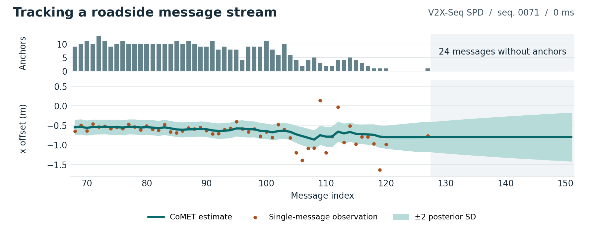

<h1 align="center">CoMET-V2X</h1>
<p align="center"><strong>Tracking the Shared Pose Error of Roadside Messages<br>for Asynchronous Vehicle–Infrastructure Cooperative 3D Detection</strong></p>
<p align="center">
  <a href="https://orcid.org/0009-0009-4809-8557">Shuwei Sun</a> ·
  <a href="https://orcid.org/0009-0007-8958-5736">Jian Huang</a> ·
  <a href="https://orcid.org/0000-0002-4985-0028">Hui Cao</a><br>
  Xi'an Jiaotong University
</p>
<p align="center">
  <a href="https://doi.org/10.5281/zenodo.23999418"></a>
</p>
<p align="center">
  <a href="paper/main.pdf"><strong>Manuscript (PDF)</strong></a> ·
  <a href="docs/PROTOCOL.md">Evaluation protocol</a> ·
  <a href="docs/FINDINGS.md">Results</a> ·
  <a href="CITATION.cff">Citation</a> ·
  <a href="https://github.com/sswun/CoMET-V2X/issues/new">Request permission</a>
</p>

**Permission to use the code and results.** Contact the authors and obtain their **prior written permission**, including for research, teaching, replication, benchmarking and commercial use. A citation alone does not grant permission. [Full terms](LICENSE) · [Contact the authors](https://github.com/sswun/CoMET-V2X/issues/new)

A roadside unit can see a car hidden behind a truck. But if the roadside pose drifts, every box in its message lands in the wrong place on the vehicle's map. **CoMET** (Common-Mode Error Tracking) estimates that shared translation from objects both sensors can see. It then corrects every roadside box, including the car behind the truck.

On the 21 official V2X-Seq SPD validation sequences, CoMET raises vehicle BEV AP70 from **63.18 to 66.63** with the same boxes and frozen readout. At the longest delay tested, 400 ms, CoMET still reaches **65.72 AP70** against **63.18** for the online-pose baseline. [Manuscript results table](paper/tables/main.tex)



*In this recorded stream, the final 24 messages contain no matched objects. The last correction still applies to roadside-only detections, while the widening band records the filter's growing uncertainty.* [Source trace](results/mechanism/KF_trajectories/KF_trajectories_author.csv.gz) · [Figure script](paper/scripts/make_readme_figure.py)

## How the receiver estimates the offset

1. **Admit a message.** At decision time `t`, the receiver uses messages captured at or before `t − d`. The experiment replays `d ∈ {0, 100, 200, 400}` ms separately. It propagates the boxes to decision time and projects them into the ego frame using online poses.
2. **Match what the two agents see.** Hungarian assignment pairs bird's-eye-view box centres. A pair qualifies as an anchor if both boxes are each other's nearest neighbour within 2.5 m. The mean `ego − remote` displacement gives one observation for the message.
3. **Carry the correction forward.** A per-stream Kalman filter keeps two translation coordinates and one variance. A message with `n` anchors has observation variance `0.6² / n`. With zero anchors, the filter keeps its last translation and increases its variance. The estimator has no learned parameters. A separately trained, frozen head ranks the late-fusion candidates. [Method and equations](paper/sec/4_method.tex)

## Detection results

Vehicle AP on `val21`, using official ground truth. Each row averages the four arrival delays. The CoMET row uses the released TraF-Align detector and averages three frozen readout heads. The V2X-ViT row averages three detector seeds. AP50 and AP70 use bird's-eye-view IoU thresholds of 0.5 and 0.7.

| Method | AP50 | AP70 |
|:---|---:|---:|
| Ego detector alone | 70.93 | 62.15 |
| Late fusion with online poses | 74.27 | 63.18 |
| V2X-ViT intermediate fusion | 77.81 | 62.96 |
| **CoMET late fusion** | **78.87** | **66.63** |

- **Across detectors.** CoMET gains **2.22–3.45 AP70 points** over uncorrected online poses across five detector checkpoints from three architectures. Against an offset estimated from the current message alone, the gains are **0.30–0.57 points**. [Per-detector contrasts and intervals](docs/FINDINGS.md#2-comet-main-method)
- **Where the metric changes the interpretation.** The official offset is exactly zero on **27.99%** of validation messages. The roadside-only labels on these frames coincide with the uncorrected projection. With the released TraF-Align detector, CoMET gains **4.53 AP70 points** on co-labelled frames and loses **3.42** on zero-offset frames relative to online poses. [Label audit and population analysis](docs/FINDINGS.md)
- **Retraining the fusion network.** TraF-Align fine-tuned with CoMET poses and cleaned training labels reaches **81.44 AP50 / 66.49 AP70**. Against the same-budget online-pose fine-tune, the paired gains are **+1.17 AP50** (95% CI 0.58–1.87) and **+0.81 AP70** (0.18–1.62). [Second-tier results](results/tier2/)

## Run the estimator

After receiving permission, the following example runs on CPU with Python 3.8+ and uses synthetic boxes. From a checkout of this repository, install the package and run its tests.

```bash
python -m pip install -e '.[test]'
python -m pytest -q
```

```python
import numpy as np
from comet import CoMETEstimator, apply_offset

tracker = CoMETEstimator(q=0.05)
stream = ("roadside-1", "vehicle-1")

# Centres in metres, already expressed in the ego frame at decision time.
remote = np.array([[10., 4.], [20., 8.], [30., 2.]])
ego = np.array([[11., 4.], [21., 8.]])  # The ego vehicle sees only two objects.
state = tracker.update(stream, remote_xy=remote, ego_xy=ego)
corrected = apply_offset(remote, state["delta"])

print(state["anchors"], corrected[-1].round(2).tolist())  # 2 [30.85, 2.0]
```

Keep the same tracker across arrivals from the same sender–receiver pair. Use a separate stream key per sequence and delay in offline replays. The standalone package provides association, filtering and box correction. The caller supplies projected, time-aligned boxes and handles downstream fusion. [Estimator source](comet/estimator.py)

## Reproducing the paper

| What you want to do | Where to start |
|:---|:---|
| Inspect the split, arrival rule, selection criterion and paired bootstrap | [Evaluation protocol](docs/PROTOCOL.md) |
| Rebuild the manuscript tables and figures from the released results | [Manuscript build instructions](paper/README.md) · [Result files](results/README.md) |
| Trace a reported contrast to its inputs or producing script | [Experiment index](docs/EXPERIMENTS.md) · [Result provenance](results/provenance/tables_v3/) · [Research script checksums](research_code/MANIFEST.csv) |
| Replay the detector experiments in the original research environment | [External code, datasets and weights](docs/THIRD_PARTY.md) · [V2X-Seq SPD data guide](https://github.com/AIR-THU/DAIR-V2X/blob/main/docs/get_started_spd.md) |

The archived verification covers **205,202 message updates** across five detector configurations and four splits. The reference implementation matched the saved offsets, observations, anchor counts and variances exactly in that run. Repeating it requires the original detector caches and accepted state files. The research scripts retain their workspace-relative artifact paths. The release includes derived statistics and filter traces. Raw sensor data, per-frame ground truth, detector predictions and weights must be obtained separately. [Verification report](results/verification/verify_against_recipe.json) · [Replay tool](tools/verify_against_recipe.py)

## Citation and permissions

For authorized use, cite the software using GitHub's **Cite this repository** action or this BibTeX entry. The version DOI identifies the archived v0.1.0 snapshot. Use the all-versions DOI to follow subsequent releases. [v0.1.0 archive](https://doi.org/10.5281/zenodo.23999418) · [All versions](https://doi.org/10.5281/zenodo.23999417) · [Citation metadata](CITATION.cff)

```bibtex
@software{sun2026cometv2x,
  author  = {Sun, Shuwei and Huang, Jian and Cao, Hui},
  title   = {{CoMET-V2X}: Tracking the Shared Pose Error of Roadside Messages for Asynchronous Vehicle--Infrastructure Cooperative 3D Detection},
  year    = {2026},
  version = {0.1.0},
  publisher = {Zenodo},
  doi     = {10.5281/zenodo.23999418},
  url     = {https://doi.org/10.5281/zenodo.23999418}
}
```

Permission requests should identify the code, tables or figures you want to use and describe the intended use. Contact Shuwei Sun through the repository and wait for the authors' written approval. Third-party materials are governed by their respective owners' terms. [Request permission](https://github.com/sswun/CoMET-V2X/issues/new) · [LICENSE](LICENSE) · [NOTICE](NOTICE)
